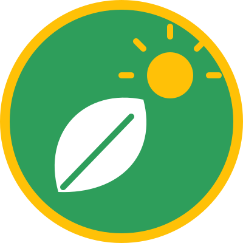
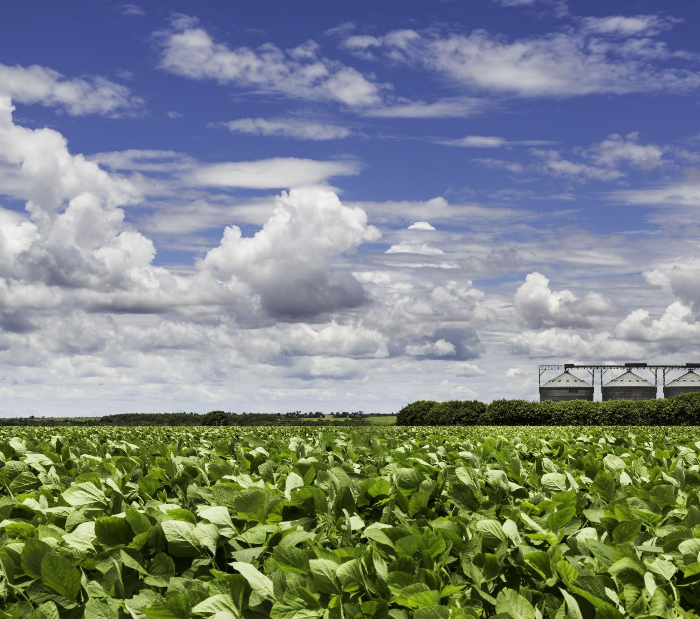
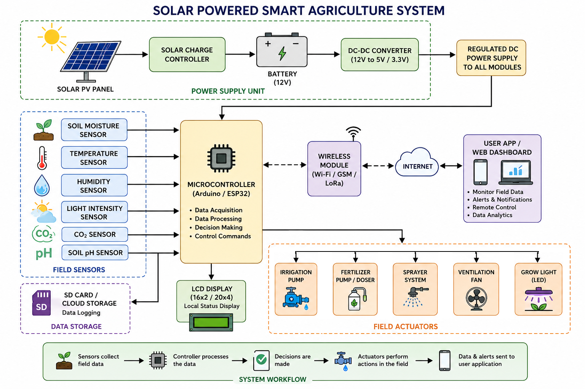
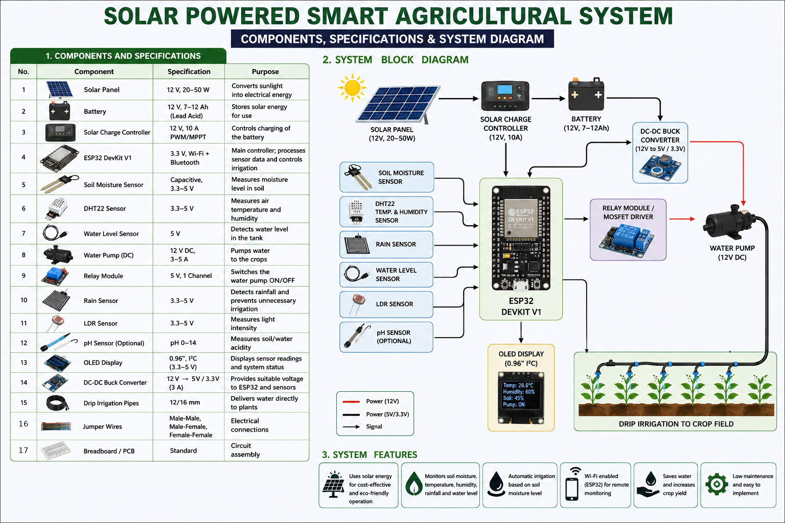
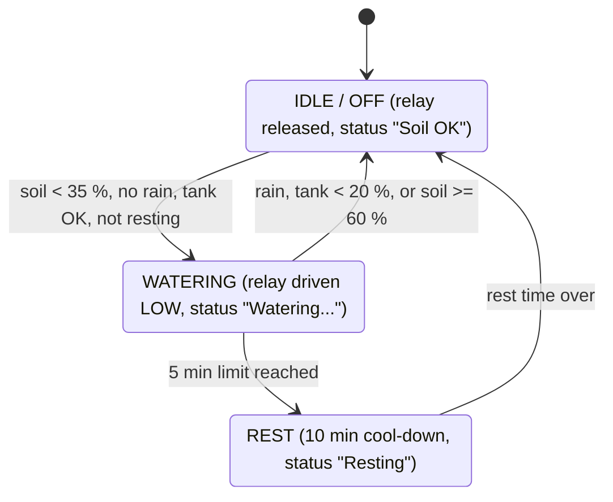

<p align="center">
  
</p>

# Solar Powered Smart Agriculture System

**TEAM AGRINOVA TECH**
*Solar-powered automated irrigation with real-time monitoring*
**Sense • Decide • Irrigate • Monitor**

ESP32 firmware for the Solar Powered Smart Agriculture (Irrigation) System. One Arduino C++ program reads six field signals, decides every 2 seconds, drives a single pump relay, and uploads the readings to the ThingSpeak cloud.

📄 The full project presentation is in [`docs/Agrinova_Final_Presentation.pptx`](docs/Agrinova_Final_Presentation.pptx).

---

## Presented by
- Sitaram Shankar Kadam

---

## 1. Problem Statement



**The Challenge**
Farmers often face problems such as unreliable electricity, water wastage, high irrigation costs, and the need for continuous manual monitoring.

**The Need**
There is a need for a solar-powered, automated irrigation system that monitors field conditions in real time and efficiently manages water resources to improve agricultural productivity while reducing energy consumption and labor.

## 2. Need of Our Project
- Efficient Water Management
- Renewable Energy Utilization
- Reduction in Labor
- Improved Crop Productivity
- Real-Time Monitoring

## 3. Block Diagram



The system has these parts: power supply unit (solar PV panel, solar charge controller, 12 V battery, DC-DC converter, regulated DC supply), field sensors, ESP32 microcontroller, wireless module, user app / web dashboard, LCD display, data storage, and field actuators.

**System workflow:** sensors collect field data → controller processes the data → decisions are made → actuators perform actions in the field → data and alerts are sent to the user application.

## 4. Components List



| No. | Component | Specification | Purpose |
|---|---|---|---|
| 1 | Solar Panel | 12 V, 20–50 W | Converts sunlight into electrical energy |
| 2 | Battery | 12 V, 7–12 Ah (Lead Acid) | Stores solar energy for use |
| 3 | Solar Charge Controller | 12 V, 10 A PWM/MPPT | Controls charging of the battery |
| 4 | ESP32 DevKit V1 | 3.3 V, Wi-Fi + Bluetooth | Main controller; processes sensor data and controls irrigation |
| 5 | Soil Moisture Sensor | Capacitive, 3.3–5 V | Measures moisture level in soil |
| 6 | DHT22 Sensor | 3.3–5 V | Measures air temperature and humidity |
| 7 | Water Level Sensor | 5 V | Detects water level in the tank |
| 8 | Water Pump (DC) | 12 V DC, 3–5 A | Pumps water to the crops |
| 9 | Relay Module | 5 V, 1 Channel | Switches the water pump ON/OFF |
| 10 | Rain Sensor | 3.3–5 V | Detects rainfall and prevents unnecessary irrigation |
| 11 | LDR Sensor | 3.3–5 V | Measures light intensity |
| 12 | pH Sensor (Optional) | pH 0–14 | Measures soil/water acidity |
| 13 | OLED Display | 0.96", I²C (3.3–5 V) | Displays sensor readings and system status |
| 14 | DC-DC Buck Converter | 12 V → 5 V / 3.3 V (3 A) | Provides suitable voltage to ESP32 and sensors |
| 15 | Drip Irrigation Pipes | 12/16 mm | Delivers water directly to plants |
| 16 | Jumper Wires | Male-Male, Male-Female, Female-Female | Electrical connections |
| 17 | Breadboard / PCB | Standard | Circuit assembly |

**System features**
- Uses solar energy for cost-effective and eco-friendly operation
- Monitors soil moisture, temperature, humidity, rainfall and water level
- Automatic irrigation based on soil moisture level
- Wi-Fi enabled (ESP32) for remote monitoring
- Saves water and increases crop yield
- Low maintenance and easy to implement

## 5. Literature Review

| Sr. No | Paper Title with Authors | Year | Outcome | Drawback / (Future Scope) |
|---|---|---|---|---|
| 1 | *Solar Powered Smart Agriculture System and Protection of Crops using Smart Fencing System* — Hamjadali A Umachagi, Shantibhai Mangaldas Patel, Basanagouda F. Ronad, Pavankumar Kulkarni, Ambaji S. Jadhav, Amit Karane | 2025 | Supports climate-smart agriculture and increases productivity. Improves farm security and resource efficiency. | **Scope:** Enhances efficiency and sustainability in agriculture. **Drawback:** Limited information on potential technical challenges. |
| 2 | *Solar-Powered Smart Agricultural Sensing Node System with Cloud-Based Visualization* — Ming-Cheng Kao, Yu-Kuan Huang, Chang-Yen Hsieh, Cheng-Hsi Lin, Tzu-Huan Huang, Kuan-Ting Shih | 2025 | Reliable long-term operation and real-time monitoring achieved. Sustainable energy independence with solar-assisted charging. | Highly scalable and cost-effective for agriculture. Limited by battery life without solar assistance. |
| 3 | *Eco Smart Solar Powered Irrigation System* — B A Sujathakumari, M Baluchandra, Sumanth P | 2024 | Significant water savings achieved through smart irrigation. Enhanced energy efficiency using solar power technology. | Significant water savings and energy efficiency. Potential limitations in arid and semi-arid regions. |
| 4 | *IoT-based solar-powered smart irrigation system with solar tracker for rice fields* — Pabel Kanti Dey, Selina Banu, Milufarzana Milufarzana, Sakib Robin, Nayon Chandra Mazumdar, Samsuzzaman Samsuzzaman, Md Shaha Nur Kabir | 2024 | Solar tracking system increased output power by 26.72%. Improved irrigation management with enhanced water use efficiency. | Huge potential for sustainable solar irrigation solutions in Bangladesh. High initial costs and technology dependency may limit accessibility. |

---

# Software Design

ESP32 firmware for the Solar Powered Smart Agriculture (Irrigation) System.

## 6. Software Overview

One Arduino-C++ program on the ESP32 reads six field signals, decides every 2 seconds, drives a single pump relay, and uploads readings to the ThingSpeak cloud. There are four software modules, all inside one non-blocking loop:

| # | Module | What it does |
|---|---|---|
| 1 | **Sensing** | DHT22 temperature and humidity, soil moisture, water tank level, rain (digital + analog) |
| 2 | **Processing** | 12-bit ADC raw values converted to 0–100 % with calibration constants |
| 3 | **Control** | Threshold rules with hysteresis, rain and tank interlocks, run-time limit |
| 4 | **Monitoring** | 16x2 I2C LCD, Wi-Fi web page with JSON API, serial log, ThingSpeak cloud charts |

**Platform:** ESP32 • Arduino IDE
**Libraries:** Wire, DHT, hd44780, WiFi, WebServer, HTTPClient, WiFiClientSecure

## 7. Hardware Interface: ESP32 Pin Map

| Device | Signal | ESP32 pin | Type |
|---|---|---|---|
| DHT22 | Temperature + humidity | GPIO 18 | Digital |
| Rain sensor | Wet / dry (DO) | GPIO 16 | Digital in |
| Rain sensor | Intensity (AO) | GPIO 35 | ADC1 |
| Water level | Tank level | GPIO 32 | ADC1 |
| Soil moisture | Soil wetness | GPIO 34 | ADC1 |
| Relay module | Pump | GPIO 23 | Output |
| I2C LCD 16x2 | SDA / SCL | GPIO 21 / 22 | I2C |

**Design choices**
- Analog sensors sit on ADC1 pins (32, 34, 35) so readings stay valid while Wi-Fi is active (avoids the known ADC2/Wi-Fi conflict on ESP32).
- ADC set to 12-bit: raw range 0–4095.
- Relay is active-low: pin driven LOW = pump ON, pin released (INPUT) = pump OFF.
- Relay is released first thing in `setup()`, so the pump is OFF at boot.

## 8. Program Flow: `setup()` and `loop()`

**`setup()` runs once**

Relay OFF ▶ Serial + ADC 12-bit ▶ I2C + LCD init ▶ DHT22 start ▶ Wi-Fi connect (20 s) ▶ Start web server

**`loop()` repeats forever**

| Step | Action | Detail |
|---|---|---|
| 1 | Serve web clients | `server.handleClient()` on every pass |
| 2 | 2 s timer | Skip the rest until 2000 ms elapsed |
| 3 | Read sensors | DHT22, rain, soil, water tank |
| 4 | Convert to % | `toPercent(raw, low, high)` |
| 5 | Control logic | Pump ON / OFF decision |
| 6 | Report | LCD, serial log, cloud upload every 20 s |

Non-blocking design: web requests are served continuously while sensors are read only every 2 seconds.

## 9. Sensor Data Processing: Raw to Percent

```cpp
int toPercent(int raw, int lo, int hi) {
  int p = map(raw, lo, hi, 0, 100);
  return constrain(p, 0, 100);
}
```

| Sensor | 0 % | 100 % |
|---|---|---|
| Soil moisture | Dry raw 3200 | Wet raw 1300 |
| Water tank | Empty raw 0 | Full raw 2000 |
| Rain intensity | Dry raw 4095 | Wet raw 1500 |

- `map()` scales linearly, `constrain()` clamps the result to 0–100 %.
- Every sensor uses the same function with its own calibration pair.
- Dry soil gives a HIGH raw value, so `lo = dry` and `hi = wet` inverts the scale.
- Re-calibrating needs only the `#define` constants.
- DHT22 values are used directly in °C and % RH; if the DHT read fails, the LCD shows `DHT22 ERROR`.

## 10. Irrigation Control: Decision Rules

| Pump turns **ON** when ALL are true | Pump turns **OFF** when ANY is true |
|---|---|
| Soil moisture < 35 % | Rain detected → `"Stopped: rain"` |
| Rain sensor: no rain | Tank below 20 % → `"Stopped:tank low"` |
| Tank level ≥ 20 % | Soil ≥ 60 % → `"Soil wet enough"` |
| Rest period not active | Ran over 5 min → `"Max time, rest"` |

**Hysteresis band 35 % → 60 %:** the pump runs until soil is clearly wet, so it does not chatter ON/OFF around one threshold.

Thresholds in the code: `SOIL_START_PCT 35`, `SOIL_STOP_PCT 60`, `TANK_MIN_PCT 20`, `PUMP_MAX_MS` = 5 minutes. The quoted strings are the `statusText` messages shown on the LCD and web page.

## 11. Pump State Machine



The rest timer only blocks a NEW start; it protects the pump motor from overheating. `restUntil = millis() + 600000` is set when the 5-minute limit fires. While resting, the pump stays off even if the soil is dry.

## 12. Built-in Protection Features

| Feature | How it works |
|---|---|
| **Rain override** | Pump stops at once and will not start while rain is sensed |
| **Dry-run protection** | Pump stops if tank falls below 20 %, so it never runs empty |
| **Run-time limit** | Hard cap of 5 minutes per cycle, then a 10 minute rest |
| **Hysteresis** | Start at 35 %, stop at 60 % soil moisture avoids rapid switching |
| **Safe boot** | Relay released first in `setup()`, so the pump is OFF on every power-up |
| **Fault display** | DHT22 failure shows `DHT22 ERROR`; Wi-Fi failure never stops irrigation |

## 13. Local Monitoring: 16x2 LCD and Serial

The LCD alternates between two pages every 2 seconds.

| Page | Row 1 | Row 2 |
|---|---|---|
| Page 1: climate, soil, tank | `T:28.5C H:62%` | `S:41% W:75%` |
| Page 2: rain and pump state | `Rain:NO 0%` | `Pump: OFF` |

- `printLine()` pads each row to 16 characters to clear old text.
- Shows the Wi-Fi IP address for 4 s at start-up.

**Serial monitor (115200 baud):** one line every 2 s with temperature, humidity, soil, tank and rain (% and raw), pump state and status text. Useful for calibration and logging.

## 14. Remote Monitoring: Wi-Fi Web Dashboard

- **`/` Dashboard:** mobile-friendly HTML page that refreshes itself every 5 s; shows temperature, humidity, soil, tank, rain, pump and status.
- **`/data` JSON API:** same readings as JSON, ready for an app, Node-RED or a cloud logger.

`GET /data` example response (illustrative sample):

```json
{
  "temp": 28.5,
  "hum": 62,
  "soil": 41,
  "tank": 75,
  "rainpct": 0,
  "rain": false,
  "pump": false
}
```

**Connection handling:** open the IP shown on the LCD in any phone browser on the same network. 20 s connect timeout at boot; retry every 30 s; irrigation keeps running if Wi-Fi is down.

## 15. Cloud Monitoring: ThingSpeak IoT

ESP32 ▶ ThingSpeak channel ▶ charts anywhere

- `sendToCloud()` builds the request from the latest readings.
- The channel stores 7 fields with a time stamp for every upload.
- View live graphs and history from any browser or phone.

| Field | Data sent | Unit |
|---|---|---|
| field1 | Temperature | °C |
| field2 | Humidity | % |
| field3 | Soil moisture | % |
| field4 | Water tank level | % |
| field5 | Rain intensity | % |
| field6 | Rain detected | 0 / 1 |
| field7 | Pump state | 0 / 1 |

**How the upload works**
- HTTPS GET to `api.thingspeak.com/update` with a write API key.
- Sent every 20 s, only when Wi-Fi is connected (ThingSpeak's free tier accepts about one update per 15 s).
- 5 s timeout; the serial log shows HTTP 200 and an entry number above 0 when it succeeds.
- If the cloud or Wi-Fi fails, local control and the LCD keep working.
- `setInsecure()` is used for a simple TLS connection without certificate checking; a certificate-checked connection is future work.

## 16. Conclusion and Future Scope

**What the software achieves**
- Fully automatic, sensor-driven irrigation
- Water saved: waters only when soil is dry, tank has water and no rain
- Pump protected by run-time, rest and tank interlocks
- Live data on LCD, phone, serial log and ThingSpeak cloud
- Simple `#define` calibration for any crop or soil

**Future scope**
- Cloud alerts (email / SMS) for low tank and sensor faults
- Manual ON / OFF button and adjustable thresholds on the web page
- Light and pH sensor support
- Wi-Fi setup portal and certificate-checked HTTPS
- Remote pump control from the cloud or a mobile app

---

# How to Run

## Hardware
Wire the components as shown in the [pin map](#7-hardware-interface-esp32-pin-map).

## Libraries (Arduino Library Manager)
- DHT sensor library (Adafruit) + Adafruit Unified Sensor
- hd44780 (Bill Perry)
- ESP32 board package (provides WiFi, WebServer, HTTPClient, WiFiClientSecure)

## Setup
1. Clone this repository.
2. In the `smart_irrigation/` folder, copy `secrets.h.example` to `secrets.h`.
3. Edit `secrets.h` with your Wi-Fi name, password and ThingSpeak **Write API key**. This file is git-ignored and is never uploaded.
4. Open `smart_irrigation/smart_irrigation.ino` in Arduino IDE, select your ESP32 board, and upload.
5. Open Serial Monitor at 115200 baud to see the IP address and live readings.

## Repository structure
```
├── README.md
├── LICENSE
├── .gitignore
├── smart_irrigation/
│   ├── smart_irrigation.ino
│   └── secrets.h.example
└── docs/
    ├── Agrinova_Final_Presentation.pptx
    └── images/
        ├── agrinova-logo.png
        ├── block-diagram.png
        ├── components-and-system-diagram.png
        └── field.jpg
```

---

<p align="center"><b>Thank You!</b><br>TEAM AGRINOVA TECH<br><i>Think. Create. Innovate. Present.</i><br>Solar Powered Smart Agriculture System</p>

## License
MIT. See [LICENSE](LICENSE).
